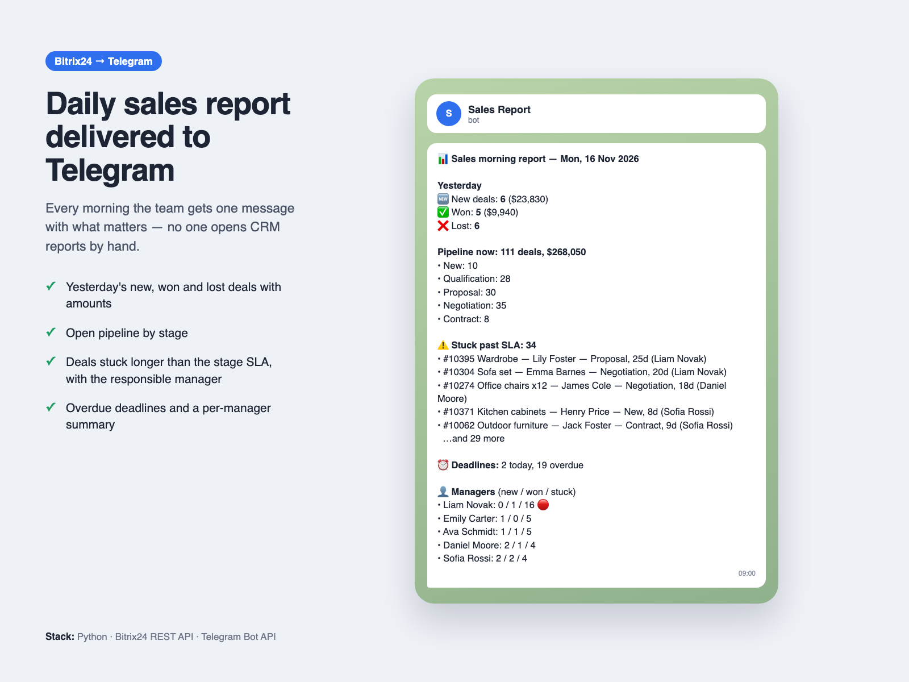
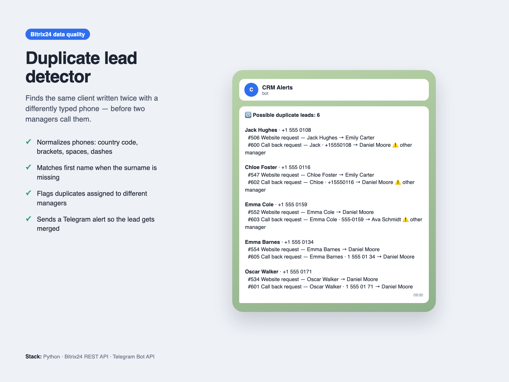

# Bitrix24 automation demos

Three small scripts for teams that sell through Bitrix24. They run on fake data out of the box, and switch to a real portal once you set an inbound webhook.

| Script | What it does |
|---|---|
| `morning_report.py` | Daily Telegram message: yesterday's new, won and lost deals, pipeline by stage, deals stuck too long in one stage, overdue deadlines, a line per manager |
| `dashboard.py` | Builds a single HTML page with the main numbers: revenue, win rate, sales cycle, stuck deals, daily trend, managers, lead sources |
| `duplicates.py` | Finds the same client entered twice with a differently written phone number, and flags it when the two leads went to different managers |



## Try it

```bash
pip install -r requirements.txt
python demo_data.py        # generates fake deals, leads and managers in data/
python morning_report.py   # prints the report
python dashboard.py        # writes out/dashboard.html
python duplicates.py       # prints the duplicate alert
```


## On a real portal

1. In Bitrix24 go to *Developer resources → Other → Inbound webhook* and give it `crm` and `user` permissions.
2. Create a Telegram bot with @BotFather and add it to your chat.
3. Set the variables and add `--send`:

```bash
export BITRIX_WEBHOOK="https://yourcompany.bitrix24.com/rest/1/xxxxxxxx/"
export TELEGRAM_TOKEN="123456:ABC..."
export TELEGRAM_CHAT_ID="-100..."
python morning_report.py --send
```

4. Put it on a schedule with cron, for example `0 9 * * 1-5`.

How many days a deal may sit in each stage is set in `b24.py` (`SLA_DAYS`). The client handles pagination and the Bitrix24 limit of about 2 requests per second.



All names, phones and deals here are made up.
